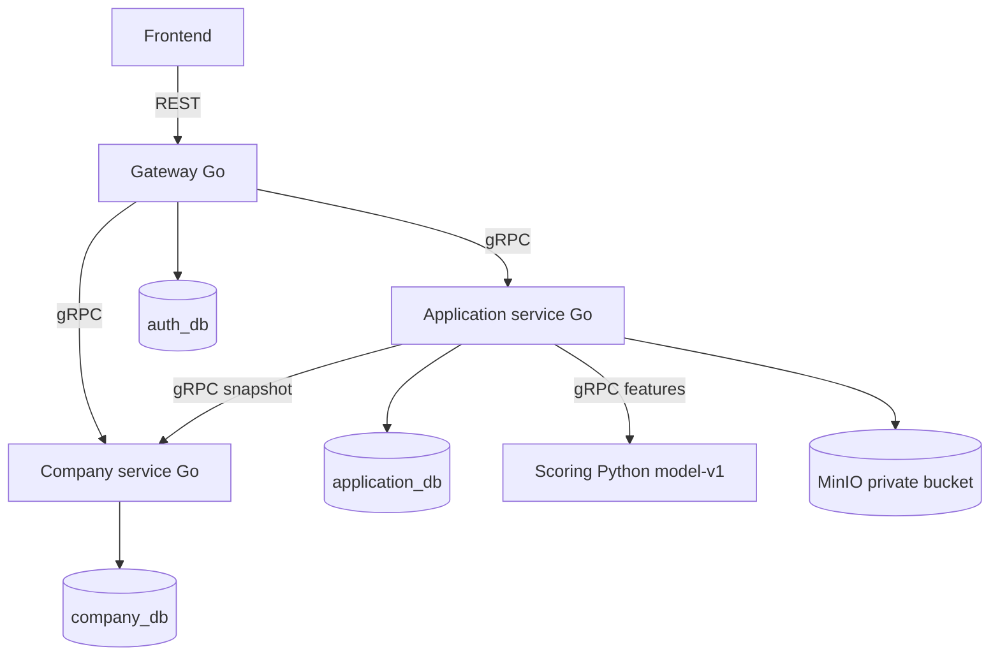
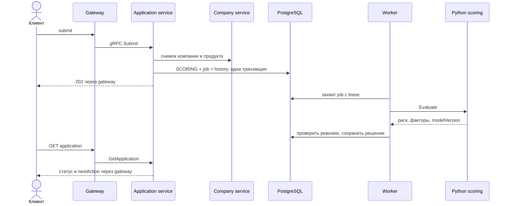
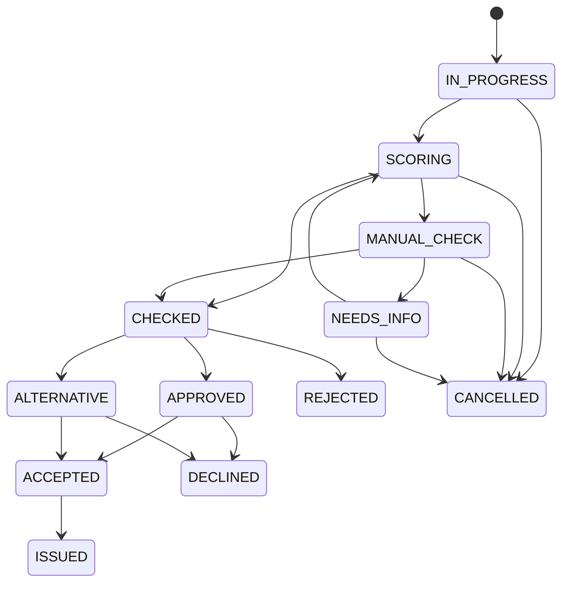
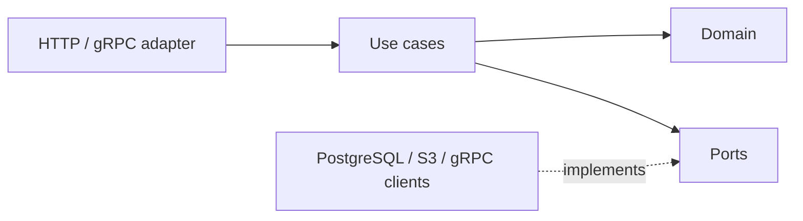

# Реализованная архитектура

Все три базы в локальном Compose обслуживаются одним PostgreSQL, доступы разделены. Gateway хранит только учётки; бизнес-сущности ему не принадлежат.

CHECKED — внутренний промежуточный переход с записью в историю, сохранённый вместе с итоговым решением. REJECTED/DECLINED/CANCELLED/ISSUED — терминальные статусы. Истечение предложения запрещает accept; самостоятельное переоформление истёкшего предложения пока вне MVP.

## Чистая архитектура

Сценарии не зависят от PostgreSQL, gRPC и S3. Ошибки, идентичность и метаданные команды передаются через platform/core. Пакет platform с транспортными зависимостями используют адаптеры и точки сборки. В домене application-service есть собственные модели снимков компании/продукта: это значения из внешней системы, не импорт внутренней модели соседнего сервиса.

## Надёжность

- Receipt и бизнес-изменение фиксируются одной SQL-транзакцией; scope включает пользователя, операцию и ключ.
- Повтор успешной команды проверяется до If-Match.
- Статус, версия и JSONB-снимок меняются под FOR UPDATE.
- У Loan уникальный application_id; выдача и статус ISSUED атомарны.
- Worker проверяет попытку, статус и ревизию. Зависшее задание возвращается в обработку после lease.
- Файл сначала имеет STAGED-запись; после SQL commit — ACTIVE. Удаление и незавершённые загрузки доводятся reconciler.
- Агрегат заявки хранится в JSONB вместе с индексируемыми колонками owner/company/status/version. Это сознательное MVP-решение: SQL-проекции и отдельные таблицы истории/документов можно выделить при росте нагрузки.

## Следующие этапы

Kafka: добавить transactional outbox к application_db; публиковать события с eventId/aggregateVersion/schemaVersion, обеспечить дедупликацию consumers. Синхронные запросы сохранить на gRPC.

Redis: сначала кэш каталога с TTL и явной инвалидацией, затем распределённый rate limiter. Решение о кредите и статус заявки не должны зависеть от доступности кэша.

Prometheus/Grafana: подключить RPC/HTTP latency, ошибки, возраст очереди заданий и время скоринга; requestId в логах уже передаётся. Пользовательские ID не использовать в labels.

Patroni/etcd/HAProxy: вынести PostgreSQL в HA-кластер с отдельными базами/ролями, подключать записи через primary endpoint, определить требования к read-after-write и резервным копиям. Это инфраструктурный этап, не часть текущего Compose.
