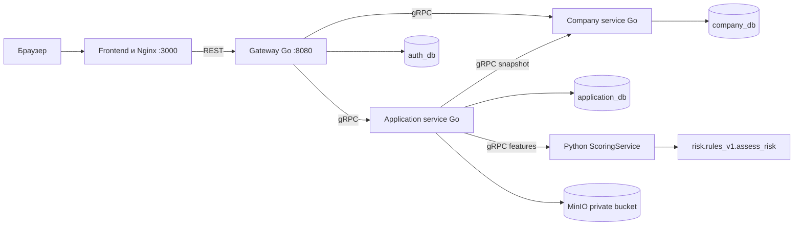
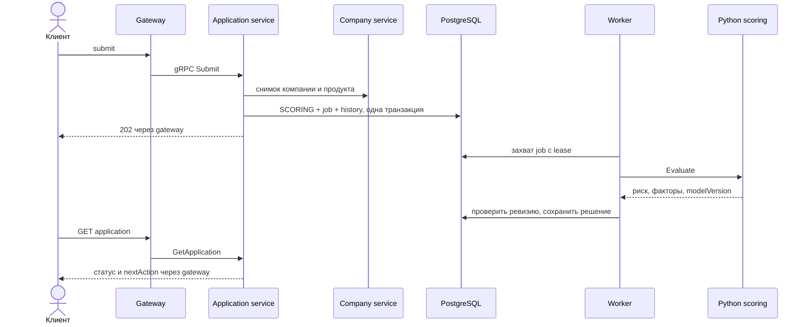
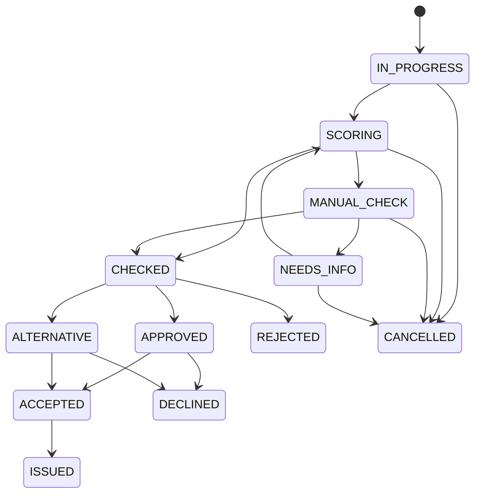
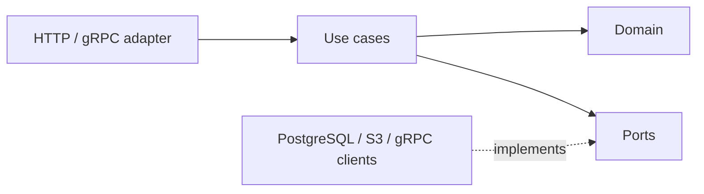

# Архитектура и интеграция

## Компоненты и запуск

Весь проект запускается из корня через `make up` или `docker compose up --build -d --wait`. Интерфейс — `http://localhost:3000`, REST API — `http://localhost:8080/api/v1`, Swagger — `http://localhost:3000/docs/`.



Все три базы в локальном Compose обслуживаются одним PostgreSQL, доступы разделены. Gateway хранит только учётки; бизнес-сущности ему не принадлежат.

[Описание модели данных](data-model.md) раскрывает сущности, связи, физическую схему и правила хранения JSONB-снимков. [Коллекция запросов](requests.md) содержит примеры вызовов API и порядок ручной проверки.

## Интеграция frontend и backend

Frontend использует реальный API вместо localStorage и демонстрационного входа. Каталог и необходимые документы загружаются после авторизации. Суммы UI в рублях преобразуются в копейки, ставки в процентах — в базисные пункты. Идентификатор frontend `business` преобразуется в backend `unsecured`; остальные совпадают. REST-списки компаний, продуктов, документов, запросов сведений и рекомендаций являются массивами, а списки заявок содержат `items` и пагинацию.

Черновик создаётся до загрузки файлов. Загрузка последовательно обновляет версию заявки; затем выполняются validation и submit с актуальным If-Match. Неотправленные файлы живут только в памяти страницы. После перезагрузки интерфейс не считает сохранённое имя файла доказательством наличия его содержимого: предлагает выбрать файл повторно либо использует уже сохранённый документ сервера. Документы можно скачать только с JWT через gateway.

При потере ответа HTTP-клиент один раз повторяет тот же запрос с тем же Idempotency-Key и If-Match, чтобы не создать вторую заявку.

Статусы заявок обновляются асинхронно. Клиентский интерфейс перечитывает их каждые четыре секунды на активной вкладке; после возврата из фонового режима обновление произойдёт на следующем интервале. История отображается из API. Сотрудник видит сохранённые баллы, версию модели и текстовые факторы. Ручные команды доступны только для MANUAL_CHECK; backend дополнительно проверяет роль и статус независимо от интерфейса.

## Обработка заявки





CHECKED — внутренний промежуточный переход с записью в историю, сохранённый вместе с итоговым решением. REJECTED/DECLINED/CANCELLED/ISSUED — терминальные статусы. Истечение предложения запрещает accept; самостоятельное переоформление истёкшего предложения пока вне MVP.

## Чистая архитектура



Сценарии не зависят от PostgreSQL, gRPC и S3. Ошибки, идентичность и метаданные команды передаются через platform/core. Пакет platform с транспортными зависимостями используют адаптеры и точки сборки. В домене application-service есть собственные модели снимков компании/продукта: это значения из внешней системы, не импорт внутренней модели соседнего сервиса.

## Надёжность

- Receipt и бизнес-изменение фиксируются одной SQL-транзакцией; scope включает пользователя, операцию и ключ.
- Повтор успешной команды проверяется до If-Match.
- Статус, версия и JSONB-снимок меняются под FOR UPDATE.
- У Loan уникальный application_id; выдача и статус ISSUED атомарны.
- Worker проверяет попытку, статус и ревизию. Зависшее задание возвращается в обработку после lease.
- Файл сначала имеет STAGED-запись; после SQL commit — ACTIVE. Удаление и незавершённые загрузки доводятся reconciler.
- Агрегат заявки хранится в JSONB вместе с индексируемыми колонками owner/company/status/version. Это сознательное MVP-решение: SQL-проекции и отдельные таблицы истории/документов можно выделить при росте нагрузки.

Nginx обновляет адрес gateway через DNS Docker, поэтому пересоздание backend-контейнера не требует ручной замены IP в frontend.

Для адресов сервисов без схемы используется passthrough target: hostname Docker заново разрешается при переподключении, а не остаётся старым IP в DNS-resolver gRPC. Задержка переподключения ограничена тремя секундами.

gRPC-клиент скоринга ожидает готового соединения в пределах таймаута вызова, чтобы краткий перезапуск Python-контейнера не расходовал все попытки немедленно. Ошибки соединения записываются в логи application-service без токенов и финансовых признаков.

## Скоринг

`scoring/app/model.py` является адаптером gRPC Features к `schema.Application` и вызывает `risk.rules_v1.assess_risk`. Dockerfile копирует `risk/` и `schema.py`; numpy/pandas не требуются для выполнения этой балльной модели, но устанавливаются для тестов генератора и метрик.

Данные о компании и финансах передаются из снимка заявки. `has_overdue_debt` преобразуется в синтетическую кредитную историю компании: при true — просрочка 90 дней, при false — отсутствие просрочек. Это демонстрационная интерпретация булевого признака, а не реальные данные БКИ. Кредитная история собственника, налоговые долги и банковские обороты не передаются текущим контрактом и остаются None. Поэтому модель явно возвращает фактор об отсутствующей истории собственника. Добавление настоящих внешних признаков требует согласованного изменения `.proto` и их источника в backend.

Результат `risk_level` преобразуется в рекомендацию APPROVE / MANUAL_REVIEW / REJECT; баллы и факторы сохраняются без пересчёта. Порог LOW — 700, MEDIUM — 500. Окончательное решение, доступная сумма, статусы и предложения остаются ответственностью application-service. Средний/высокий риск направляется на ручное рассмотрение.

`scoring/app/product_rules.py` содержит отдельные продуктовые расчёты коллег и покрыт тестами. Текущий публичный подбор остаётся в company-service, а решение о сумме — в application-service: этот дополнительный модуль не подменяет их автоматически. Его 12 детальных сценариев требуют дополнительных данных об имуществе, маркетплейсах и тарифах; такие данные текущий gRPC-контракт не содержит. Неизвестные значения при интеграции не выдумываются.

## Проверка

```sh
make check-go
make test-python
make api
make up
make e2e
make e2e-contract
```

Браузерные сценарии:

```sh
cd frontend
npm ci
npx playwright install chromium
FRONTEND_URL=http://localhost:3000 npm run test:e2e
```

Набор в `frontend/tests/integration/` проверяет регистрацию и вход, условия каталога, создание заявки, загрузку и побайтовое скачивание PDF, сохранение после перезагрузки, выдачу, запрос дополнительных сведений, ручное одобрение, альтернативное предложение и разграничение клиент/сотрудник. Старые тесты автономного прототипа сохранены в корне `frontend/tests/` для справки и не запускаются актуальным Playwright config.
