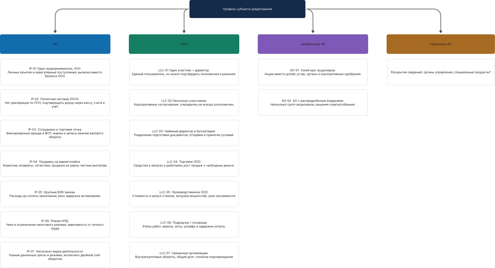
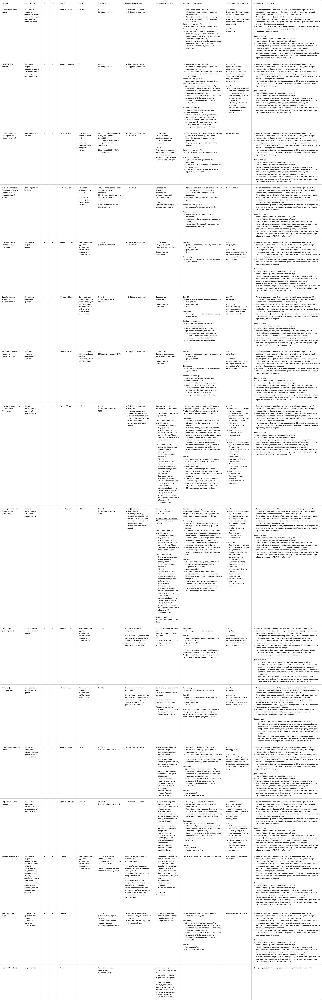
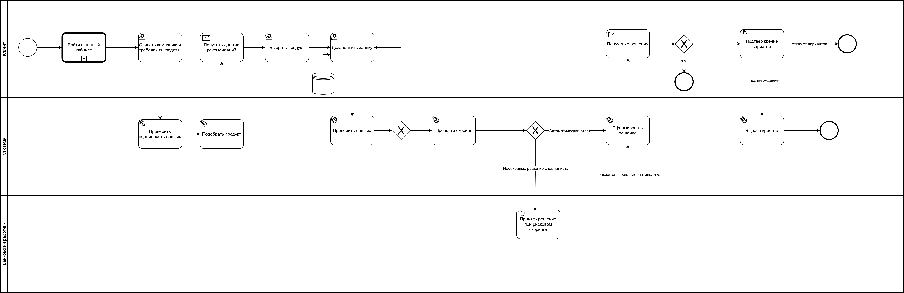

# Бизнес документация личного кабинета кредитования бизнеса

## 1 Product Discovery

### 1.1 Исследование целевой аудитории

#### Сегменты бизнеса

Основной маршрут MVP ориентирован на действующие ИП и небольшие ООО. Для них создаётся общий сценарий подбора и подачи заявки с различающимися требованиями к реквизитам, финансовым документам и правам пользователя. Варианты для акционерных обществ отражают более широкое поле исследования, но не требуют отдельного клиентского маршрута в первой версии.
#### Роли и потребности
После определения того, для какого бизнеса создаётся решение, необходимо определить, кто именно взаимодействует с ним. Поэтому следующий артефакт раскрывает проблемы представителей клиента и сотрудников банка и связывает их с функциями личного кабинета.

| Роль                                           | Что мешает                                            | Как используется вывод                                             |
| ---------------------------------------------- | ----------------------------------------------------- | ------------------------------------------------------------------ |
| Собственник ИП или руководитель ООО            | Непонятные условия, неопределённость результата       | Подбор по цели, сравнение и явное принятие конкретного предложения |
| Бухгалтер или финансовый специалист            | Разные источники, периоды, повторный ввод             | Сохранение черновика, источник и период данных                     |
| Операционный или иной уполномоченный сотрудник | Недостаток сведений на первом этапе, запросы коллегам | Сохранение черновика                                               |
| Клиентский менеджер банка                      | Неполнота и повторные запросы                         | Единый перечень замечаний и история дополнений                     |
| Кредитный аналитик                             | Несопоставимые показатели и конфликтующие сведения    | Раздельные результаты проверки, скоринга и оценки сделки           |
| Уполномоченный сотрудник банка                 | Рекомендация не объясняет ограничения                 | Обязательная причина и проверка полномочий при решении             |
Анализ ролей показал, что одного интерфейса «отправить заявку» недостаточно. Для клиента необходимы сохранение контекста, прозрачность условий и отсутствие повторного ввода. В то же время для банковской стороны важно единое досье, происхождение показателей и фиксация оснований решения. 
### 1.2 Jobs to Be Done
На основе исследования целевой аудитории был использован продуктовых подход Jobs to be done для формулировки потребностей и их решений.

| Формулировка Jobs to Be Done                                                                                                      | Функция продукта                                                 | Проверяемый результат                                                            |
| --------------------------------------------------------------------------------------------------------------------------------- | ---------------------------------------------------------------- | -------------------------------------------------------------------------------- |
| Когда возникла потребность, хочу определить цель, сумму и срок, чтобы получить достаточно средств без лишнего долга               | Мастер потребности, минимально полезная сумма, собственный вклад | Зафиксированы цель, сумма, срок и дата; пользователь понимает источник погашения |
| Когда выбираю финансирование, хочу понять подходящие варианты и различия, чтобы сделать осознанный выбор                          | Подбор, карточки, сравнение                                      | Можно объяснить применимость и существенное отличие двух вариантов               |
| Когда сомневаюсь в доступности продукта, хочу заранее узнать явные ограничения, чтобы не заполнять бесполезную заявку             | Предварительная проверка требований                              | Неизвестные условия отделены от подтверждённого несоответствия                   |
| Когда оформляю заявку, хочу использовать уже введённые сведения, чтобы не отвлекаться надолго от бизнеса                          | Перенос данных, черновик, сохранение                             | Цель, сумма, срок и известные реквизиты не вводятся повторно                     |
| Когда собираю финансовые сведения, хочу видеть единый перечень и источники, чтобы передать полное досье                           | Перечень по продукту и форме бизнеса, документы и периоды        | По каждому обязательному пункту виден результат проверки или конкретный пробел   |
| Когда заявка рассматривается, хочу понимать этап и следующий шаг, чтобы планировать дела                                          | Статусы, история, адресные уведомления                           | Клиент различает ожидание банка и необходимость собственного действия            |
| Когда банк сообщает результат, хочу понять условия, причину и альтернативы, чтобы решить, подходит ли предложение                 | Объяснение, сравнение с исходным запросом, выбор ответа          | Клиент видит, покрывает ли сумма задачу, и что означает принятие                 |
| Когда я рассматриваю заявку как сотрудник банка, хочу видеть факты, риск и ограничения сделки, чтобы принять обоснованное решение | Единое досье, ручная очередь, фиксация оснований                 | Решение воспроизводимо по версии данных и указанным основаниям                   |

### 1.3 Варианты кредитования и правила их представления
После описания потребностей выполнено сопоставление кредитных инструментов по цели финансирования, форме бизнеса, сумме, сроку, стоимости, погашению, обеспечению и другим условиям. Такая структура нужна, чтобы подбирать финансирование по хозяйственной задаче клиента, а не только по названию банковского продукта. Полная матрица остаётся справочником для проектирования.

## 2 Business Process

### 2.1 Границы, участники и результаты процесса

**Начало:** представитель бизнеса входит в кабинет с потребностью в финансировании или возвращается к ранее сохранённой заявке.

**Основной результат:** по выбранному и отправленному запросу зафиксировано решение — одобрение, альтернативные условия или отказ; клиенту понятны основания и дальнейшие действия. Запрос дополнительных сведений и ручное рассмотрение являются промежуточными результатами.

**Завершение отдельного обращения:** отказ банка, отзыв клиента, истечение срока предложения либо принятые условия с последующим условным оформлением и моделированием выдачи. Незавершённый черновик сохраняется; отсутствие подходящего продукта завершает подбор, не создавая банковского отказа.

**Вне процесса первой версии:** реальная выдача и подписание, регистрация обеспечения, обслуживание задолженности после выдачи, взыскание, реструктуризация, кредитный комитет с несколькими согласующими, полноценное финансирование групп компаний и интеграции с действующими банковскими системами.

| Участник                           | Ответственность                                                                                             | Входные данные                                                              | Результат действия                                                                           |
| ---------------------------------- | ----------------------------------------------------------------------------------------------------------- | --------------------------------------------------------------------------- | -------------------------------------------------------------------------------------------- |
| Представитель клиента              | Формулирует потребность, подтверждает сведения, направляет заявку и отвечает на предложение в пределах прав | Профиль бизнеса, финансовые сведения, документы, параметры потребности      | Отправленная версия, дополнение, принятие или отзыв                                          |
| Кабинет и автоматическая обработка | Сохраняют контекст, проверяют полноту, выполняют расчёты и обеспечивают допустимую последовательность       | Заявка, каталог, результаты проверок и действующие демонстрационные правила | Статус, результаты оценки, адресный запрос или решение разрешённого автоматического маршрута |
| Сотрудник банка                    | Разбирает исключения, уточняет сведения и подтверждает решение в пределах полномочий                        | Единое досье, расхождения, результаты оценки заёмщика и сделки              | Обоснованное действие с автором и причиной                                                   |
| Источники сведений                 | Предоставляют факты на определённую дату, а не решение банка                                                | Идентификатор бизнеса и разрешенный запрос                                  | Успешный ответ, отсутствие сведений, противоречие или недоступность                          |

### 2.2 BPMN
После определения состава участников и допустимых исходов необходимо согласовать порядок действий между клиентом, системой и сотрудником банка. BPMN фиксирует последовательность и развилки.
