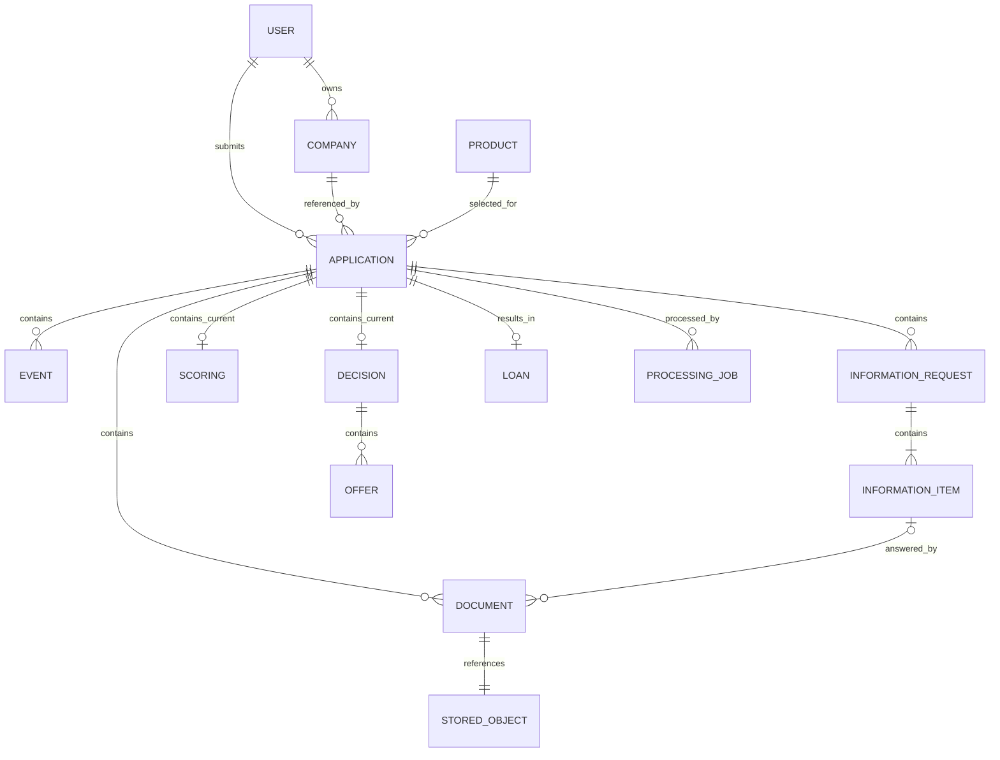

# Описание модели данных

## Хранилища и владельцы данных

Локальный Docker Compose использует один экземпляр PostgreSQL с тремя отдельными базами и ролями. Сервисы обращаются только к своей базе; сведения соседнего сервиса получают через gRPC. Файлы документов хранятся в закрытом bucket `credit-documents` в MinIO.

| Хранилище | Владелец | Содержимое |
|---|---|---|
| `auth_db`, роль `auth_user` | Gateway | Пользователи, роли и хеши паролей |
| `company_db`, роль `company_user` | Company service | Профили компаний, финансовые данные и каталог продуктов |
| `application_db`, роль `application_user` | Application service | Заявки, решения, документы, история, задания скоринга и выдачи |
| MinIO, bucket `credit-documents` | Application service | Содержимое загруженных PDF/JPEG/PNG |

Python scoring не имеет собственной базы: принимает признаки по gRPC и возвращает результат. Сохранением результата управляет application-service. JWT выдаётся gateway и не хранится в таблице сессий.

## Сущности и связи

Это логическая диаграмма: она включает вложенные JSON-объекты и межсервисные ссылки. Реальные SQL foreign key заданы только у `loans.application_id` и `processing_jobs.application_id`, оба указывают на `applications.id`. Между отдельными базами PostgreSQL foreign key нет. Документы, события, скоринг, решения и предложения не имеют собственных SQL-таблиц.

Один пользователь CLIENT может владеть несколькими компаниями. У компании один владелец `ownerId`; приглашения, делегирование и совместный доступ нескольких представителей не реализованы. Заявка принадлежит одному пользователю и относится к одной компании и одному выбранному продукту. Сотрудник EMPLOYEE получает доступ к банковской очереди по роли; отдельной таблицы назначенных исполнителей нет.

## Физическая схема PostgreSQL

### `auth_db`

`users` хранит `id` (primary key), уникальный `login`, `display_name`, `role` и `password_hash`. Ограничение `CHECK` допускает только CLIENT и EMPLOYEE. Пароль хранится как bcrypt-хеш. Помимо уникальности `login`, миграция 002 создаёт уникальный индекс `lower(login)` для защиты от регистрации одного email в разном регистре.

### `company_db`

| Таблица | Колонки и ограничения | Назначение |
|---|---|---|
| `companies` | `id` PK, `owner_id`, `data jsonb`; индекс по `owner_id` | Текущий профиль компании |
| `products` | `id` PK, `data jsonb` | Демонстрационный каталог кредитных продуктов |
| `command_receipts` | `scope` PK, `payload_hash`, `response jsonb`, `expires_at` | Результаты идемпотентных команд компании |

`companies.data` содержит объект `Company`: ID, владельца, версию, статус и сообщение проверки, а также вложенный `data` с реквизитами, представителем и финансовыми показателями. Финансовые значения включают месячные выручку, расходы и долговые платежи, годовые показатели, денежный поток, остаток долга и признак просрочки. `companies.owner_id` дублирует владельца из JSON для выборки по пользователю.

`products.data` содержит объект `Product`: ID, название, допустимые цели, минимальные и максимальные суммы и сроки, ставку, требования к документам, обеспечение, тип расчёта платежа и теги. Каталог первоначально заполняется из `domain.Products()`. Seed использует `ON CONFLICT DO NOTHING`: изменение исходного списка само по себе не перезаписывает уже существующие строки каталога.

### `application_db`

| Таблица | Колонки и ограничения | Назначение |
|---|---|---|
| `applications` | `id` PK, `owner_id`, `company_id`, `status`, `version`, `data jsonb`, `created_at`, `updated_at` | Текущий агрегат заявки и колонки для выборок |
| `loans` | `id` PK, `application_id` UNIQUE FK, `data jsonb` | Одна моделируемая выдача на заявку |
| `processing_jobs` | `id` PK, `application_id` FK, `revision`, `attempts`, `state`, `next_run_at`, `lease_until`; UNIQUE (`application_id`, `revision`) | Надёжная очередь скоринга |
| `document_objects` | `object_key` PK, `state`, `created_at` | Состояние объекта MinIO и фоновая очистка |
| `command_receipts` | `scope` PK, `payload_hash`, `response jsonb`, `expires_at` | Результаты идемпотентных команд заявки |

У `applications` есть индексы (`owner_id`, `created_at DESC`) и (`status`, `created_at DESC`). Номер заявки, название компании, ИНН, название продукта и рекомендация при фильтрации читаются из JSONB. Отдельных индексов на эти JSON-поля текущая миграция не создаёт.

`document_objects` не хранит FK на заявку. Связь с документом определяется его `objectKey` внутри агрегата. В этой таблице могут временно находиться STAGED-объекты, которым ещё не соответствует сохранённый документ заявки.

### Служебные данные миграций

При запуске каждый из трёх Go-сервисов создаёт в своей базе `schema_migrations`: `name` PK, `checksum`, `applied_at`. Таблица фиксирует применённые SQL-файлы и их SHA-256. Изменение уже применённого файла приводит к ошибке запуска; изменения схемы оформляются следующей миграцией.

## Агрегат заявки и JSONB-снимки

`applications.data` хранит сериализованный `domain.Aggregate`. Это текущий полный документ заявки, а не только анкета. Основные поля `Application` находятся на верхнем уровне JSON, поскольку структура встроена в `Aggregate`.

| Поле JSON | Содержимое |
|---|---|
| `id`, `number`, `ownerId`, `companyId`, `productId` | Идентификаторы и отображаемый номер |
| `need`, `consents` | Сумма, срок, цель, описание потребности и согласия |
| `status`, `version`, `nextAction`, `missingFields` | Состояние и следующий шаг |
| `createdAt`, `updatedAt` | Время создания и изменения |
| `companyName`, `inn`, `productName`, `recommendation` | Поля отображения и фильтрации |
| `companySnapshot` | Копия компании, её версии, финансовых данных и проверки |
| `productSnapshot` | Копия параметров и требований выбранного продукта |
| `documents` | Метаданные документов и закрытые ключи объектов MinIO |
| `scoring` | Последний сохранённый скоринг: баллы, уровень риска, факторы, версия модели, проверки и рекомендация |
| `decision` | Текущее решение, причина и массив предложений `offers` |
| `acceptedOfferId` | ID предложения, выбранного клиентом |
| `informationRequests` | Запросы сведений и пункты с ID, типами, обязательностью и состояниями |
| `events` | История переходов: время, исходный и новый статусы, сообщение и роль инициатора |
| `loan` | Моделируемая выдача; тот же объект записывается в `loans.data` |
| `submitted` | Признак того, что заявка уже отправлялась |

Скалярные колонки SQL и одноимённые поля агрегата сохраняются одной операцией в одной транзакции. Колонки предназначены для индексов и выборок, JSONB содержит полное состояние. Прямое редактирование одной из копий вне репозитория сервиса может нарушить согласованность.

### Когда меняются снимки

1. При создании черновика application-service получает компанию и продукт через gRPC и сохраняет их копии в заявку.
2. При допустимом PATCH с `need` перечитывается и обновляется снимок компании; сменить саму компанию заявки нельзя. При PATCH с `productId` обновляется снимок продукта; после первой подачи выбрать другой продукт нельзя.
3. При каждой отправке, включая повторную после запроса сведений, снимки компании и продукта обновляются из company-service. Комплектность и параметры проверяются по этим данным.
4. После отправки worker получает признаки из сохранённого снимка заявки. Простое изменение профиля компании или каталога не переписывает ранее сохранённую заявку автоматически.

Таким образом, снимок фиксирует данные конкретной обработки, но не является неизменяемым на всём жизненном цикле. В JSONB хранится текущий снимок. Отдельного архива всех снимков, решений и результатов скоринга по версиям нет: `events` сохраняет события, но не полные предыдущие агрегаты. Повторная отправка очищает текущие решение и скоринг, затем сохраняет новые результаты. Поле `version` служит контролю конкурентных изменений и не означает наличие всех прошлых версий в хранилище.

## Документы и MinIO

`documents[]` содержит ID, ID заявки, тип, имя файла, MIME, размер, SHA-256, статус, `requestItemId` и `objectKey`. Необязательный `requestItemId` связывает файл с пунктом запроса дополнительных сведений. Обычный документ не обязан отвечать на такой запрос. `objectKey` используется внутри сервиса и не выдаётся клиенту как публичный URL.

Содержимое файла хранится только в MinIO. Gateway передаёт файл потоком, application-service проверяет формат и размер и вычисляет SHA-256. Для согласования SQL и объектного хранилища применяется следующий порядок:

1. В `document_objects` создаётся STAGED-запись и загружается объект.
2. Метаданные добавляются в агрегат, а запись объекта становится ACTIVE в SQL-транзакции.
3. При удалении документ исключается из агрегата, объект помечается DELETING.
4. Фоновый reconciler удаляет DELETING-объекты и STAGED-объекты старше часа, затем их служебные строки.

PostgreSQL и MinIO не объединены общей транзакцией. Промежуточные состояния позволяют завершить очистку после ошибки или перезапуска.

## Транзакции, версии и повторные команды

При изменении заявки её строка блокируется через `SELECT ... FOR UPDATE`. Сервис проверяет роль, владельца, допустимый статус и `If-Match`. Успешная команда повышает `version`; агрегат, индексируемые колонки, события и связанные SQL-изменения сохраняются атомарно.

`command_receipts.scope` состоит из пользователя, операции и `Idempotency-Key`. Для этого scope берётся транзакционная advisory-блокировка. Успешный ответ хранится в `response` 24 часа. Повтор с тем же хешем тела возвращает сохранённый результат до проверки текущей версии заявки; другое тело с тем же ключом вызывает конфликт. Вход, регистрация, предварительный расчёт, подбор и проверка комплектности не сохраняют такие receipts.

Отправка сохраняет SCORING и новое задание `processing_jobs` одной транзакцией. Worker забирает задание с `SKIP LOCKED` и lease на 45 секунд. Перед сохранением результата проверяются попытка задания, статус SCORING и совпадение версии заявки с `revision`. Отменённая или изменённая заявка не получает устаревший результат. После трёх неудачных вызовов скоринга заявка направляется на ручное рассмотрение.

Выдача создаёт `loans` и переводит заявку в ISSUED одной транзакцией. Уникальный `loans.application_id` дополнительно запрещает вторую выдачу по той же заявке.

## Представления и ограничения модели

API возвращает необходимые представления агрегата: карточку заявки, решение, скоринг, документы, историю и банковский обзор. Это не отдельные хранилища. Лента строится из текущих состояний последних 100 заявок пользователя и общей рекомендации; собственной таблицы новостей нет.

Время передаётся как UTC RFC3339, суммы RUB — в целых копейках, ставки — в базисных пунктах, сроки — в месяцах. ID — непрозрачные строки. SQL хранит даты заявки как `timestamptz`, а вложенный JSON — как строки времени.

История фиксирует роль инициатора события, но не отдельное поле с ID автора. В текущей модели также нет таблиц корпоративных полномочий, архива финансовых периодов, настоящих договоров, счетов и платежей. ФНС/БКИ и выдача моделируются локально.
