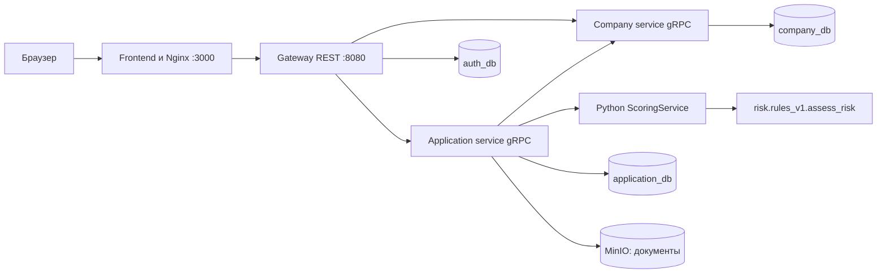

# Интеграция frontend, backend и scoring

Nginx обновляет адрес gateway через DNS Docker, поэтому пересоздание backend-контейнера не требует ручной замены IP в frontend.

Весь проект запускается из корня через `make up` или `docker compose up --build -d --wait`. Интерфейс — `http://localhost:3000`, REST API — `http://localhost:8080/api/v1`, Swagger — `http://localhost:3000/docs/`.



Frontend использует реальный API вместо localStorage и демонстрационного входа. Каталог и необходимые документы загружаются после авторизации. Суммы UI в рублях преобразуются в копейки, ставки в процентах — в базисные пункты. Идентификатор frontend `business` преобразуется в backend `unsecured`; остальные совпадают. REST-списки компаний, продуктов, документов, запросов сведений и рекомендаций являются массивами, а списки заявок содержат `items` и пагинацию.

Черновик создаётся до загрузки файлов. Загрузка последовательно обновляет версию заявки; затем выполняются validation и submit с актуальным If-Match. Неотправленные файлы живут только в памяти страницы. После перезагрузки интерфейс не считает сохранённое имя файла доказательством наличия его содержимого: предлагает выбрать файл повторно либо использует уже сохранённый документ сервера. Документы можно скачать только с JWT через gateway.

При потере ответа HTTP-клиент один раз повторяет тот же запрос с тем же Idempotency-Key и If-Match, чтобы не создать вторую заявку.

Статусы заявок обновляются асинхронно. Клиентский интерфейс перечитывает их каждые четыре секунды на активной вкладке; после возврата из фонового режима обновление произойдёт на следующем интервале. История отображается из API. Сотрудник видит сохранённые баллы, версию модели и текстовые факторы. Ручные команды доступны только для MANUAL_CHECK; backend дополнительно проверяет роль и статус независимо от интерфейса.

Для адресов сервисов без схемы используется passthrough target: hostname Docker заново разрешается при переподключении, а не остаётся старым IP в DNS-resolver gRPC. Задержка переподключения ограничена тремя секундами.

gRPC-клиент скоринга ожидает готового соединения в пределах таймаута вызова, чтобы краткий перезапуск Python-контейнера не расходовал все попытки немедленно. Ошибки соединения записываются в логи application-service без токенов и финансовых признаков.

## Подключение работы ML-разработчика

`scoring/app/model.py` теперь является адаптером gRPC Features к `schema.Application` и вызывает `risk.rules_v1.assess_risk`. Прежняя независимая балльная формула удалена. Dockerfile копирует `risk/` и `schema.py`; numpy/pandas не требуются для выполнения этой балльной модели, но устанавливаются для тестов генератора и метрик.

Финансовые данные передаются из снимка заявки, а внешние сведения application-service получает перед скорингом из сервиса `external-mocks` (`mocks/`, адрес — `EXTERNAL_MOCKS_URL`):

- `GET /fns/v1/companies/{inn}` — статус компании, ИП/ООО, ОКВЭД, дата регистрации, налоговый долг;
- `GET /bki/v1/reports/{inn}` — кредитная история компании и собственника; запрашивается только при согласии `creditHistoryCheck`;
- `GET /bank/v1/accounts/{inn}` — обороты по счёту.

Мок отвечает на любой ИНН из 10 или 12 цифр стабильными синтетическими данными, производными от ИНН. Готовые профили для демонстрации и тестов лежат в `mocks/profiles.json`: `7700000000` — надёжная компания (сквозные сценарии), `0000090029` — просрочки у собственника, `0000090036` — налоговый долг, `0000090043` — ликвидирована, `000000900509` — ИП без кредитной истории, `000000900682` — БКИ не отвечает.

Проверки `FNS_MOCK` и `BKI_MOCK` в ответе скоринга строятся по реальным ответам мока: `PASSED` — источник ответил и негативных сведений нет, `FAILED` — есть негативные сведения (ликвидация, налоговый долг, просрочки), `UNAVAILABLE` — источник не ответил или нет согласия. Ликвидированная компания получает отказ без ручной проверки. Автоматическое решение принимается только при `LOW` риске и всех проверках `PASSED`, иначе заявка уходит сотруднику. Если источник недоступен, данные не выдумываются: скоринг не получает соответствующее сообщение и не штрафует за «отсутствующую историю». Флаг «есть просроченная задолженность» в анкете удалён: кредитная история берётся из БКИ.

Результат `risk_level` преобразуется в рекомендацию APPROVE / MANUAL_REVIEW / REJECT; баллы и факторы сохраняются без пересчёта. Порог LOW — 700, MEDIUM — 500. Окончательное решение, статусы и предложения остаются ответственностью application-service. Средний/высокий риск направляется на ручное рассмотрение.

Доступную сумму считает скоринг (`scoring/affordability/dscr.py`), application-service передаёт ему снимок продукта в `ScoringInput.product` и получает `Scoring.affordability`:

- свободный денежный поток CFADS = выручка − расходы за месяц;
- допустимый новый платёж — меньшее из CFADS / 1,20 (DSCR ≥ 1,20) и CFADS × 0,8 (стресс-сценарий −20%, DSCR ≥ 1,00), за вычетом текущих платежей по кредитам;
- наибольшая сумма — обратная аннуитетная формула по запрошенному сроку и ставке продукта, с округлением вниз до 1000 ₽; платёж по ней считается так же, как `domain.Payment` в Go, и не превышает допустимый;
- для кредитной линии и овердрафта (`ANNUITY_ESTIMATE`) — оценка при полном использовании лимита.

При LOW риске и пройденных проверках application-service одобряет запрошенную сумму, если она не больше расчётной, иначе предлагает расчётную (`ALTERNATIVE`), а если расчётная ниже минимума продукта — отказывает. Причина решения содержит пояснение из `affordability.reason`. Если платёжеспособность не рассчитана (нет выручки или модели платежей), заявка уходит сотруднику. Детальные сценарии 12 продуктов (залог, маркетплейсы, господдержка, транши) описаны в `scoring/draft.md` и в расчёт пока не входят.

## Проверка

```sh
make check-go
make test-python
make api
make up
make e2e
make e2e-contract
```

Браузерные сценарии:

```sh
cd frontend
npm ci
npx playwright install chromium
FRONTEND_URL=http://localhost:3000 npm run test:e2e
```

Набор в `frontend/tests/integration/` проверяет регистрацию и вход, условия каталога, создание заявки, загрузку и побайтовое скачивание PDF, сохранение после перезагрузки, выдачу, запрос дополнительных сведений, ручное одобрение, альтернативное предложение и разграничение клиент/сотрудник. Старые тесты автономного прототипа сохранены в корне `frontend/tests/` для справки и не запускаются актуальным Playwright config.

## Результат проверки 26 октября 2026

- `make check-go`: форматирование, vet, тесты с race detector и сборка трёх Go-сервисов прошли. Включён тест восстановления соединения со scoring.
- `make test-python`: 27 тестов прошли, включая модуль риска, генератор и продуктовые правила.
- `make api`: OpenAPI корректен.
- `scripts/check_api.py --extended`: 12/12 этапов, 34/34 операции, 185 запросов; документы действительно сохраняются в MinIO и скачиваются с исходным содержимым.
- `make e2e-contract`: все сквозные сценарии прошли с проверкой ответов по OpenAPI.
- Playwright/Chromium: 9/9 браузерных сценариев прошли на Docker-интерфейсе. Проверен также повтор создания заявки после потерянного ответа: используется тот же ключ и вторая заявка не создаётся.
- После пересоздания scoring и frontend API-проверка прошла повторно. После пересоздания gateway браузерные сценарии прошли без перезапуска frontend.
- Production-сборка frontend и сборка обновлённых Go-контейнеров прошли; Nginx config проверен через `nginx -t`. Все семь постоянно работающих контейнеров healthy.

Браузерный прогон в этой среде выполнен в отдельном временном Linux-контейнере с headless Chromium; он не является зависимостью проекта или сервисом Compose. Тесты использовали синтетические данные. Коммиты и push при интеграции не выполнялись.
